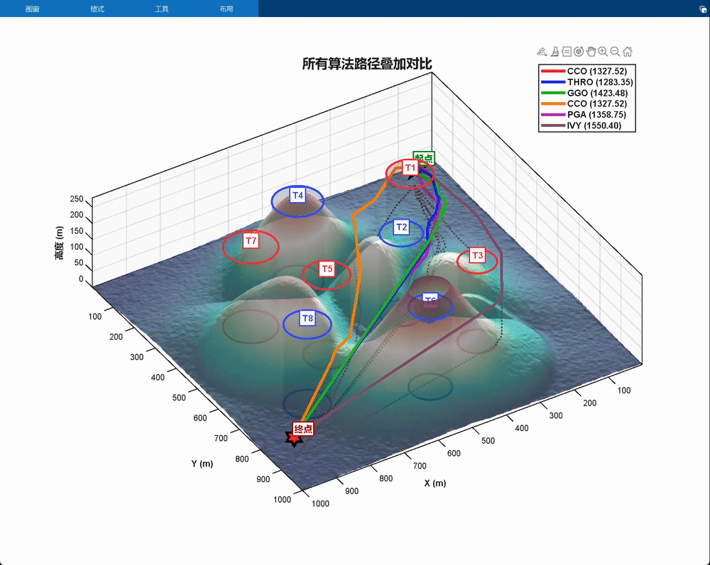
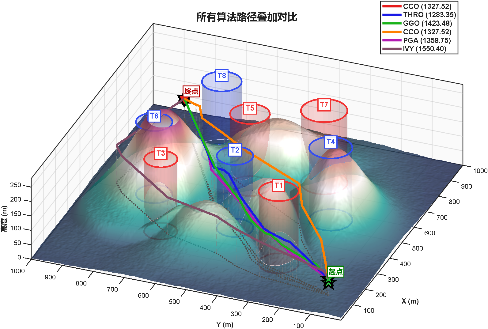
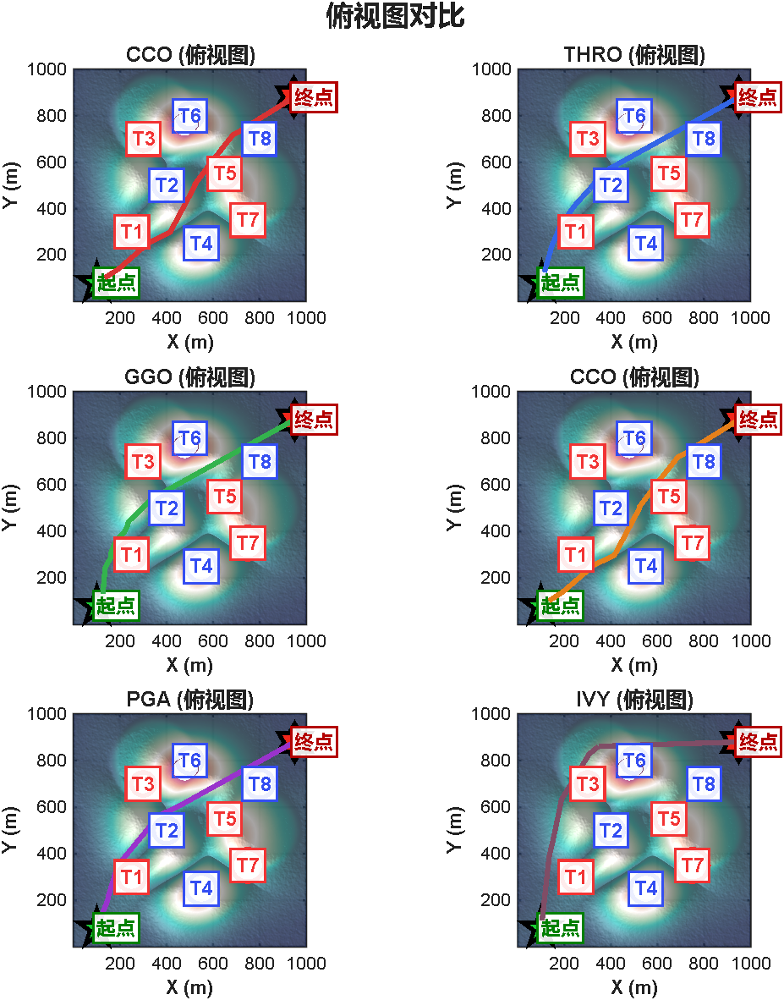
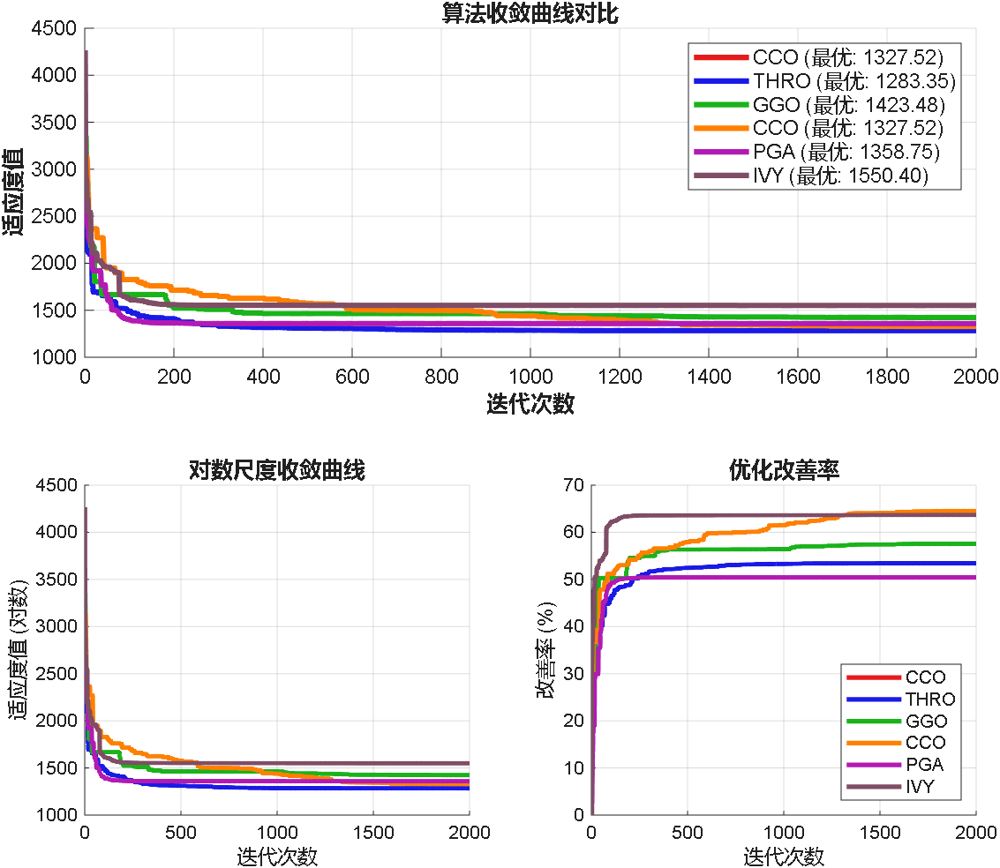
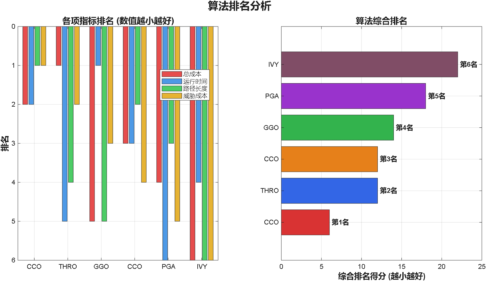
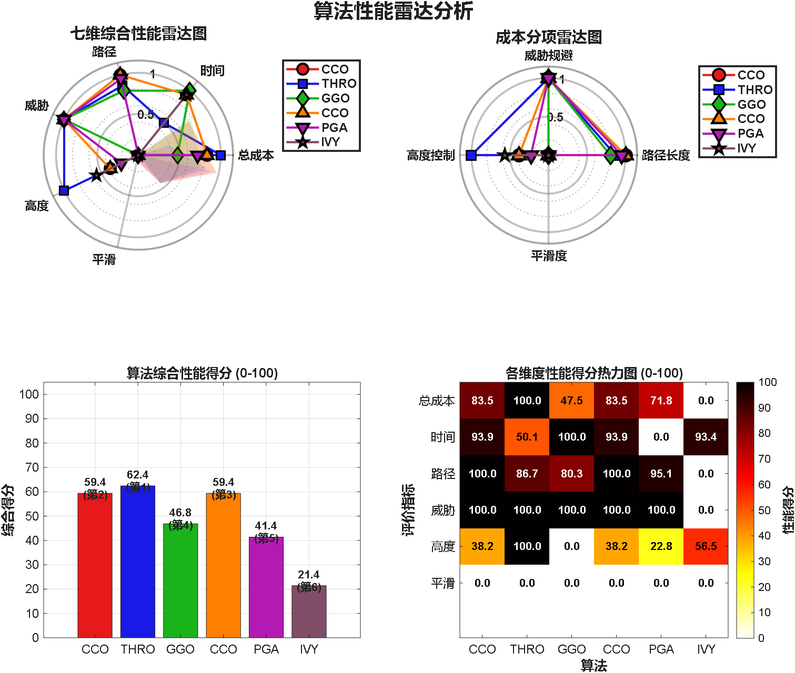
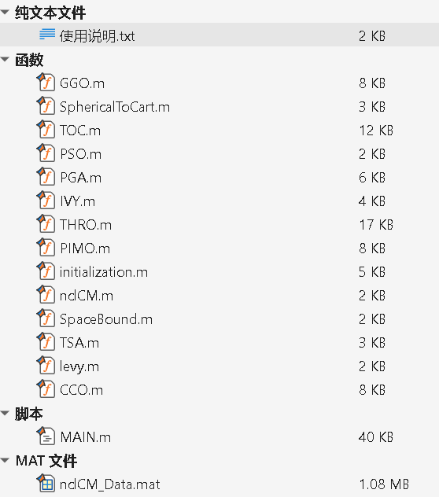

# Comparative Analysis of Six Top-tier Journals' First-Class Intelligent Algorithms for Path Planning in Complex Mountain Environments with Drones

This article uses six top-tier journal one-region intelligent algorithms for comparison, achieving drone path planning in complex mountainous environments. 
The six one-region intelligent algorithms are as follows: 
2025 May - The latest computer field one-region top-tier journal optimization algorithm - THROO (Thrombosis Optimization Algorithm) by Tian Jie's horse racing optimization algorithm (THRO) 
Highly cited! ESWA one-region algorithm - Grey Goose Optimization Algorithm (GGO), 
2025 Computer field top-tier one-region - Tornado Optimization Algorithm (TOC), 
2025 July - The latest one-region algorithm - Light Up Growth Algorithm (PGA), 
Recommended one-region optimization algorithm - Ivy Leaf Optimizer, MATLAB code is free to obtain, 
2025 September - The latest optimization algorithm - Cherry Blossom Carp Optimizer. 
These six algorithms have all been published in previous articles, and you can click the above article link to jump to the detailed introduction of the algorithm. 
Background introduction 
Drone path planning is one of the core technologies in drone autonomous navigation, which directly affects the flight efficiency, safety, and quality of task completion of the drone. In complex three-dimensional environments, the drone needs to avoid various obstacles and threat areas while maintaining a reasonable flight height and smooth flight trajectory. 
Traditional single algorithms often cannot perform well in all scenarios, so this issue has developed a multi-algorithm drone path planning comparison system, integrating six advanced optimization algorithms to provide comprehensive solutions for drone path planning. 
Problem modeling 
The specific content of problem modeling can refer to this document: 
[1] Wang Wentao, Ye Chen, Tian Jun. A Three-Dimensional Drone Path Planning Method Based on Multi-Strategy Improved Artificial Turtle Optimization Algorithm [J]. Journal of Electronics, 2024, 52(11):3780-3797. 
In the original literature, there were only four constraints, namely: distance cost, threat cost, flight height cost, and smoothness cost, and this issue added a collision cost based on these four costs.
The cost function consists of five components, corresponding to the five optimization objectives of path planning:
1. Path length (J1) - The path length is the sum of the Euclidean distances from the starting point to all waypoints along the path. The objective is to minimize this path length.
2. Threat cost (J2) - The threat cost is a penalty for paths that are close to threat areas. Each threat area is modeled as a cylinder, and we calculate the distance from each segment of the path to the center of the threat area. If the distance is less than the sum of the threat radius plus the drone's radius plus a safety distance, a penalty is generated. The penalty value increases with decreasing distance; if the path crosses the threat area (distance is less than the sum of the threat radius plus the drone's radius), a very large penalty (J_inf) is given.
3. Altitude cost (J3) - The altitude cost aims to maintain the drone flying at an appropriate altitude. We expect the drone to fly between a specified minimum altitude and maximum altitude, and to be close to an ideal altitude (the middle value). Any deviation in altitude from the ideal altitude at each waypoint will result in a cost.
4. Smoothness cost (J4) - The smoothness cost includes the rate of change in turning angles and climb angles. We calculate the changes in turning angles (horizontal direction) and climb angles (vertical direction) between adjacent path segments. If the change exceeds the maximum allowable value (45 degrees), a penalty is generated.
5. Terrain collision cost (J5) - A new cost added to ensure that the drone does not collide with terrain. We check the ground height (absolute height minus terrain height) at each waypoint and on the sample points within the path segment. If the ground height is less than a minimum safe clearance (15 meters), a penalty is generated. If a collision occurs (ground height is negative), a very large penalty is given.
We weight these five costs together to form a single-objective optimization problem:
Total Cost = b1 * J1 + b2 * J2 + b3 * J3 + b4 * J4 + b5 * J5
After experimenting and tuning, the following weights were selected:
b₁ = 1% Path length - Base Importance
\n        \n      \n        \n  
\n        \n      \n        \n      \n        \n      \n        \n      The above is a comparison chart of all problem-solving methods. Due to the above comparison, it can easily highlight the ranking order of various algorithms.
Under complex paths, it is actually more reflective of an algorithm's strengths and weaknesses! In this code, the map changes are very convenient!
Code Directory
\n        \n      Run the MAIN script file!

## Images

<!-- PAYMENT_BLOCK -->

## Get this dataset

- Payment link (Stripe): [Buy now](https://buy.stripe.com/3cs8yP7sY87d0vu9AB)
- Payment QR code: 

<!-- /PAYMENT_BLOCK -->
